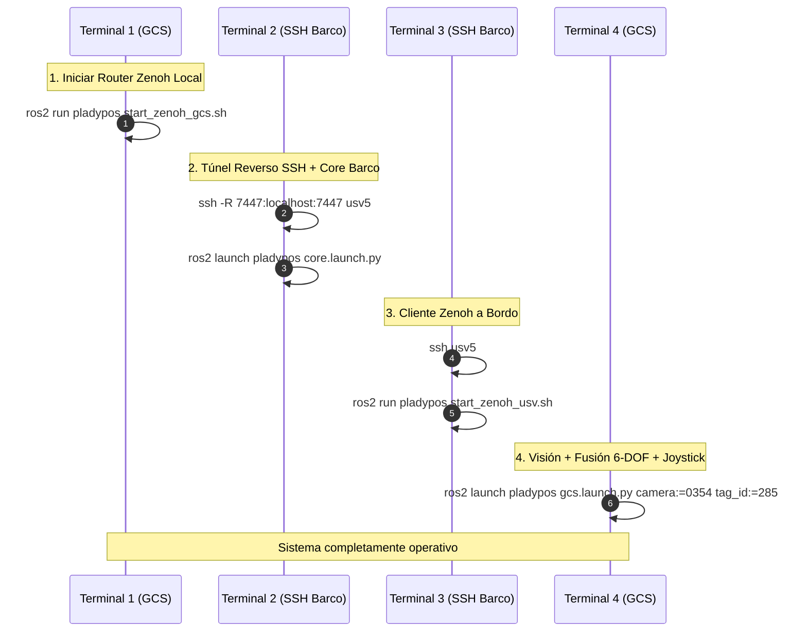

# Pladypos USV: Guía de Usuario y Protocolo de Inicio Rápido (SOP)

Este documento es la **Guía Operativa de Usuario** para iniciar y operar el sistema completo de teleoperación, telemetría y estimación de estado 6-DOF del barco autónomo (`pladypos-usv5`) desde la estación de tierra (GCS Laptop).

---

## 📋 Resumen Rápido de Terminales

Para operar el sistema se utilizan 4 terminales en tu laptop:



---

## 🚀 Paso a Paso (4 Terminales)

> **Nota:** Como el entorno ROS 2 ya está configurado en tu `~/.bashrc`, no necesitas hacer `source` manualmente.
> Si los relojes de la laptop y el barco se desfasan, puedes sincronizarlos automáticamente en 1 segundo con:
> `ros2 run pladypos sync_boat_time.sh` (toma tu zona horaria y tu hora y se la pasa al barco).

### 🖥️ Terminal 1 (GCS Laptop) — Iniciar Router Zenoh
```bash
ros2 run pladypos start_zenoh_gcs.sh
```

---

### 🚢 Terminal 2 (GCS Laptop -> Barco) — Túnel y Core del Barco
1. Abre conexión con el barco reenviando el puerto Zenoh:
   ```bash
   ssh -R 7447:localhost:7447 usv5
   ```
2. Dentro del barco:
   ```bash
   ros2 launch pladypos core.launch.py
   ```

---

### 🔗 Terminal 3 (GCS Laptop -> Barco) — Enlace Zenoh a Bordo
1. Abre otra conexión con el barco:
   ```bash
   ssh usv5
   ```
2. Dentro del barco:
   ```bash
   ros2 run pladypos start_zenoh_usv.sh
   ```

---

### 🎮 Terminal 4 (GCS Laptop) — Lanzamiento GCS (Visión + Fusión + Joystick + Pileta)
En tu laptop:
```bash
ros2 launch pladypos gcs.launch.py camera:=0354 tag_id:=285
```
*(Inicia el detector de AprilTag, la fusión 6-DOF, el joystick y publica los límites de la pileta para RViz).*

---

## 🗺️ Visualización de la Pileta y Barco en RViz
Para ver el barco navegando dentro de los límites de la pileta en tiempo real:
1. Abre RViz en tu laptop: `rviz2`
2. En **Global Options** fija **Fixed Frame**: `odom`
3. Dale a **Add -> By topic**:
   - `/pool_boundary` $\rightarrow$ Tipo **Marker** (dibuja el perímetro de la pileta en color cian).
   - `/tf` (muestra el frame `usv5_odom` moviéndose en tiempo real).
   - `/usv5/odometry/filtered` $\rightarrow$ Tipo **Odometry** (flecha de orientación y trayectoria).

---

## 🔍 Verificación Rápida de Diagnóstico
En cualquier terminal adicional de tu laptop puedes verificar que todo fluye correctamente:

1. **Verificar IMU desde el barco a 100 Hz:**
   ```bash
   ros2 topic hz /usv5/imu/data
   ```
2. **Verificar Visión AprilTag a ~25 Hz (latencia 2.6 ms):**
   ```bash
   ros2 topic hz /usv5/visual_odom
   ```
3. **Verificar Odometría Filtrada a 30 Hz:**
   ```bash
   ros2 topic hz /usv5/odometry/filtered
   ```
4. **Verificar anclaje rígido a Z = 0.00:**
   ```bash
   ros2 topic echo /usv5/odometry/filtered --field pose.pose.position
   ```

---

## 🔄 Protocolo de Actualización de Código en el Barco
Cuando realices cambios en los nodos del barco (`core.launch.py`, `driver_imu.py`, etc.):

1. En tu laptop abre una sesión SSH con proxy reverso SOCKS5:
   ```bash
   ssh -R 8888 usv5
   ```
2. Dentro del barco ejecuta:
   ```bash
   cd ~/ros2usv_ws/src/pladypos
   git -c http.proxy=socks5h://127.0.0.1:8888 pull
   cd ~/ros2usv_ws && colcon build --packages-select pladypos --symlink-install
   source install/setup.bash
   ```

---

## 🛑 Cómo Bajar Todo el Sistema Limpiamente
- En cada terminal presiona `Ctrl + C`.
- Para asegurar que ningún proceso quede en segundo plano en tu laptop:
  ```bash
  killall -9 zenoh-bridge-ros2dds 2>/dev/null
  ```
