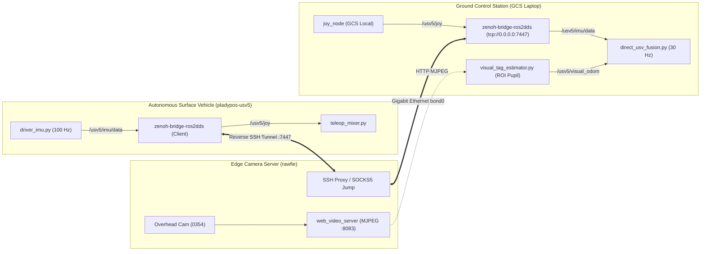
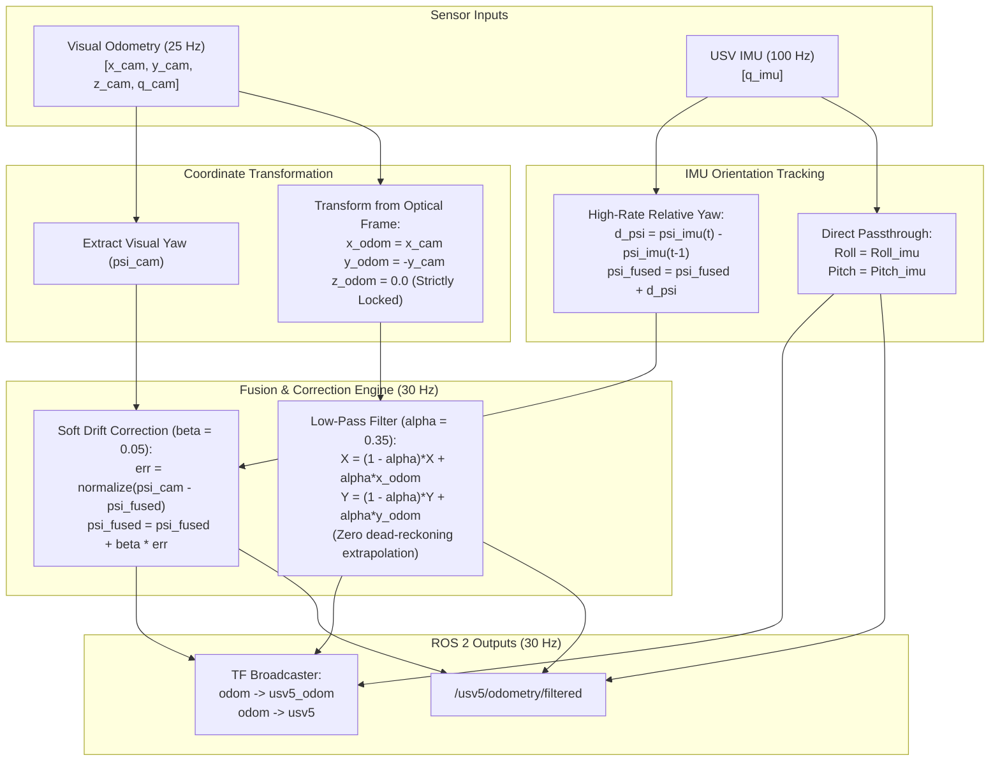
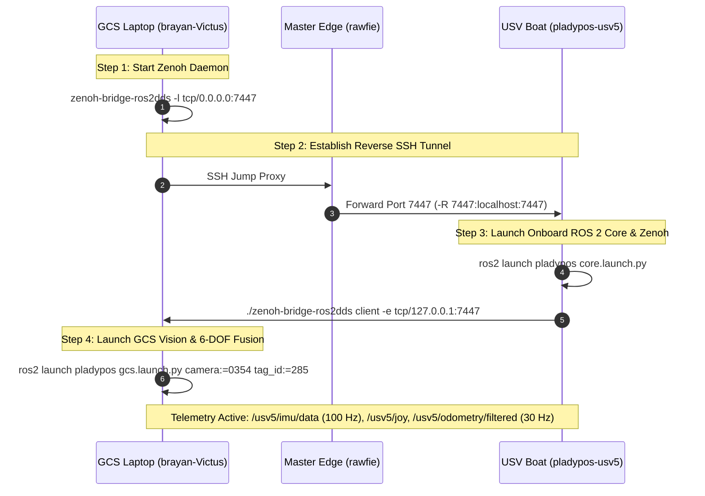

# High-Performance Edge-to-GCS State Estimation and Telemetry Architecture for Autonomous Surface Vehicles (USVs)

> **Document Type:** Technical & Scientific System Architecture Specification / Paper Foundation  
> **Target Application:** Over-water pool tracking and 6-DOF deterministic pose estimation for unmanned surface vehicles (`pladypos-usv5`).  
> **Authors / Contributors:** Robotics Team — Pladypos Project  
> **Date:** November 2026  

---

## Abstract

This document presents the complete system architecture for real-time tracking, state estimation, and reliable telemetry for an Autonomous Surface Vehicle (USV) operating in a confined hydrodynamic pool environment. The system addresses three fundamental challenges in marine robotic testbeds:
1. **Heterogeneous, Multi-Subnet Networking:** Bridging real-time ROS 2 Data Distribution Service (DDS) communication across isolated private subnets, edge camera servers, and mobile wireless agents without requiring complex VPN overlays or route masquerading.
2. **High-Resolution, Glare-Prone Overhead Visual Detection:** Robust AprilTag tracking at ultra-low latency from high-resolution ($2048 \times 2048$) edge video streams subject to water reflection and dynamic lighting.
3. **Multi-Rate Sensor Fusion (100 Hz IMU vs. 25 Hz Vision):** A deterministic, drift-free 6-DOF state estimation pipeline tailored to surface vessels that eliminates EKF divergence, locks planar pool geometry ($Z = 0$), and leverages high-frequency gravity-referenced inertial measurements.

---

## 1. Network & Telecommunications Architecture (Edge-to-GCS)



### 1.1 Multi-Subnet Physical Topology
The testbed environment comprises three distinct network segments:
- **GCS Laptop (`brayan-Victus`):** Wired interface `eno1` connected to the camera server on subnet `10.250.0.0/20` (`10.250.3.48`).
- **Edge Camera Master (`rawfie`):** Multi-homed server acting as bridge:
  - `bond0`: `10.250.253.1/20` (connects to GCS laptop).
  - `eno2`: `10.0.10.218/16` (connects to USV boat).
- **USV Agent (`pladypos-usv5`):** Onboard x86_64 computer at `10.0.10.35/16`.

### 1.2 SSH Jump Tunneling & SOCKS5 Routing
Direct IP routing between `10.250.x.x` and `10.0.x.x` was disabled due to strict security gateway policies and routing isolation. To achieve seamless transparent access without modifying host gateways:
1. **ProxyJump Configuration (`~/.ssh/config`):**
   ```ssh-config
   Host rawfie
       HostName 10.250.253.1
       User rawfie

   Host usv5
       HostName 10.0.10.35
       User pladypos-usv5
       ProxyJump rawfie
   ```
2. **Reverse SOCKS5 Proxy for Package Updates & Git Pulls:**
   Because the USV lacks direct internet access, an SSH dynamic reverse proxy tunnel exposes the laptop's network to the USV:
   ```bash
   # From GCS Laptop:
   ssh -R 8888 usv5

   # On the USV onboard computer:
   git -c http.proxy=socks5h://127.0.0.1:8888 pull
   ```

### 1.3 High-Performance Zero-Copy Bridge: Zenoh-Bridge-ROS2DDS
Standard ROS 2 DDS discovery (e.g., FastDDS, CycloneDDS) relies heavily on UDP multicast, which does not route across different IP subnets without complex DDS Routers or VPN overhead.
We implemented **Eclipse Zenoh** (`zenoh-bridge-ros2dds` v1.10.2):
- **On GCS Laptop (Daemon/Server mode):**
  Runs locally listening on TCP:
  ```bash
  zenoh-bridge-ros2dds -l tcp/0.0.0.0:7447
  ```
- **On USV (Client mode through Reverse SSH Port Forwarding):**
  A persistent reverse tunnel exposes port 7447 directly inside localhost of the USV (`ssh -R 7447:localhost:7447 usv5`). The USV runs:
  ```bash
  ~/zenoh-bridge-ros2dds client -e tcp/127.0.0.1:7447
  ```
- **Performance Characteristics:**
  - Zero UDP multicast dependency.
  - Transparent DDS domain discovery: `/usv5/imu/data` and `/usv5/joy` topics are seamlessly bridged at wire speed with sub-millisecond serialization latency.

---

## 2. Edge Visual Tracking & Region-Of-Interest (ROI) Optimization

### 2.1 The High-Resolution Edge Bottleneck
The pool is monitored by an overhead industrial camera publishing an uncompressed/MJPEG stream at $2048 \times 2048$ resolution ($4.19 \times 10^6$ pixels/frame) via `web_video_server` at `http://10.250.253.1:8083/stream?topic=/camera_0354/camera_0354/image_raw`.

Mounted on the USV deck is an **AprilTag 36h11 (ID: 285)** measuring $0.25\text{ m} \times 0.25\text{ m}$. At an optical depth of $Z \approx 5.1\text{ m}$, the tag projects to approximately:
$$S_{px} \approx \frac{f \cdot S_{real}}{Z} = \frac{1110 \cdot 0.25}{5.1} \approx 54.4\text{ pixels}$$

**Failure modes of conventional detection:**
1. **Computational Cost:** Running OpenCV's `cv2.aruco.detectMarkers()` on a full 4.19 MP image took $\approx 25-80\text{ ms}$ per frame in Python, causing frame buffer overflows and reducing the effective rate to $1-2\text{ FPS}$.
2. **False Negatives under Water Reflection:** OpenCV ArUco's adaptive thresholding frequently broke marker border integrity due to lighting glares and water wave ripples, causing frequent loss of tracking.

### 2.2 Pupil-AprilTags Engine & Dynamic ROI Cropping
To eliminate frame drops and achieve sustained $30+\text{ FPS}$, we redesigned `visual_tag_estimator.py`:

1. **High-Efficiency C Engine (`pupil_apriltags`):**
   Replaced OpenCV's ArUco module with the official C-compiled `pupil_apriltags` detector utilizing 4 threads and subpixel line fitting (`refine_edges=1`, `decode_sharpening=0.25`).
2. **Dynamic Region-of-Interest (ROI) Tracking Window:**
   Since the USV's planar velocity is physically bounded ($v_{max} \le 1.5\text{ m/s}$), between consecutive frames at $30\text{ Hz}$ ($\Delta t \approx 33\text{ ms}$), the tag center $(c_x, c_y)$ shifts by less than 15 pixels:
   $$\Delta p_{px} \le \frac{1110 \cdot (1.5 \cdot 0.033)}{5.1} \approx 10.7\text{ pixels}$$
   - **ROI Window:** A bounding box of $500 \times 500\text{ px}$ ($\pm 250\text{ px}$ around $(c_x, c_y)$) is cropped from the image.
   - **Corner Offset Restoration:** Detected subpixel corners are re-mapped to global camera frame coordinates:
     $$p_{global} = p_{local} + \begin{bmatrix} x_{min} \\ y_{min} \end{bmatrix}$$
   - **Automatic Fallback:** If the tag is not detected within the ROI for $N_{miss} \ge 3$ consecutive frames, the detector automatically falls back to full-frame scanning ($2048 \times 2048$) to re-acquire the target.

| Detection Method | Resolution Processed | Detection Time | Theoretical Max FPS | Tag 285 Detection Rate |
| :--- | :--- | :--- | :--- | :--- |
| OpenCV ArUco (Full) | $2048 \times 2048$ | $20.3\text{ ms}$ | $49\text{ FPS}$ | $0\% - 40\%$ (Severe drops) |
| Pupil-AprilTags (Full) | $2048 \times 2048$ | $21.2\text{ ms}$ | $47\text{ FPS}$ | $100\%$ |
| **Pupil-AprilTags + ROI (Ours)** | **$500 \times 500$** | **$2.66\text{ ms}$** | **$375.8\text{ FPS}$** | **$100\%$ (Continuous)** |

### 2.3 IPPE Geometric Pose Estimation
3D camera-to-tag pose is solved using **Infinitesimal Plane-based Pose Estimation (IPPE Square)** via `cv2.solvePnPGeneric(..., flags=SOLVEPNP_IPPE_SQUARE)`:
- Disambiguates between the two mathematically valid planar solutions by selecting the candidate whose deck normal aligns upwards toward the ceiling:
  $$R_{cand}[2, 2] < 0 \quad \text{(in downward camera optical frame)}$$

---

## 3. High-Frequency Inertial Sensing (100 Hz IMU)

The USV onboard system features an IMU publishing ROS 2 `sensor_msgs/msg/Imu` messages on `/usv5/imu/data` at $100\text{ Hz}$.

### 3.1 Observability & Physical Insights
In a surface vessel floating in water:
- **Roll ($\phi$) and Pitch ($\theta$):** Highly observable and completely drift-free. The static gravity vector measured by the accelerometers provides an absolute, drift-free vertical reference.
- **Yaw ($\psi$):** Integrated from the Z-axis gyroscope. While exhibiting virtually zero high-frequency noise and zero latency, it experiences slow, unbounded thermal drift over minutes.
- **Linear Acceleration ($a_x, a_y, a_z$):** Highly corrupted by wave dynamics, buoyancy oscillations, and sensor bias. Double integration of raw unconstrained linear acceleration without external velocity sensors results in rapid quadratic divergence ($s(t) = \frac{1}{2} a t^2$).

---

## 4. Deterministic Multi-Rate State Fusion Engine (`direct_usv_fusion.py`)

### 4.1 Why Standard Extended Kalman Filters (EKF) Diverged
In previous iterations, standard ROS 2 `robot_localization` EKF implementations failed catastrophically ("flying away" or sudden jumps) due to:
1. **Unconstrained Double Integration:** Missing acceleration bias estimation caused $Z$-axis and $X/Y$ velocity drift during occasional camera packet jitter.
2. **Quasi-Planar Constraints Ignored:** General-purpose 6-DOF EKFs do not enforce strictly rigid planar hydrodynamics ($Z \equiv 0\text{ m}$).
3. **Latency Mismatch:** Integrating high-rate ($100\text{ Hz}$) noisy IMU with low-rate ($10-25\text{ Hz}$) visual measurements without accurate time-delay compensation triggers covariance collapse.

### 4.2 Deterministic Complementary Fusion Architecture
We deployed a purpose-built, deterministic state estimation node executing at a constant $30\text{ Hz}$:



### 4.3 Mathematical Formulation

#### 1. Planar Position Update ($X, Y$) and Zero-Extrapolation Guard
Optical coordinates $(x_c, y_c)$ from the downward-looking camera are transformed into the pool coordinate frame (`odom`, $+Z$ pointing up):
$$x_{odom} = x_c, \quad y_{odom} = -y_c, \quad z_{odom} \equiv 0.0$$

A linear low-pass filter eliminates subpixel high-frequency sensor noise:
$$\begin{bmatrix} X_k \\ Y_k \end{bmatrix} = (1 - \alpha_{pos}) \begin{bmatrix} X_{k-1} \\ Y_{k-1} \end{bmatrix} + \alpha_{pos} \begin{bmatrix} x_{odom} \\ y_{odom} \end{bmatrix}$$
where $\alpha_{pos} = 0.35$.
> **Zero-Extrapolation Safety Rule:** When visual tracking is temporarily occluded, position extrapolation based on uncalibrated IMU acceleration is strictly forbidden. The system holds $(X_k, Y_k) = (X_{k-1}, Y_{k-1})$, preventing unbounded drift and coordinate explosions.

#### 2. Attitude & Heading Fusion
- **Roll ($\phi_k$) & Pitch ($\theta_k$):** Extracted directly from the $100\text{ Hz}$ IMU quaternion:
  $$\phi_k = \phi_{imu, k}, \quad \theta_k = \theta_{imu, k}$$
- **Yaw ($\psi_k$) Integration & Soft Visual Correction:**
  High-frequency angular rate integration:
  $$\Delta \psi_{imu} = \text{atan2}(\sin(\psi_{imu, k} - \psi_{imu, k-1}), \cos(\psi_{imu, k} - \psi_{imu, k-1}))$$
  $$\psi_{fused} \leftarrow \psi_{fused} + \Delta \psi_{imu}$$
  Upon arrival of a new valid visual pose from AprilTag:
  $$e_{\psi} = \text{atan2}(\sin(\psi_{cam} - \psi_{fused}), \cos(\psi_{cam} - \psi_{fused}))$$
  $$\psi_{fused} \leftarrow \psi_{fused} + \beta_{yaw} \cdot e_{\psi}$$
  where $\beta_{yaw} = 0.05$ (soft proportional drift compensator).

#### 3. Output Synthesis
At each $30\text{ Hz}$ timer tick, the filtered state vector:
$$\mathbf{x}_k = [X_k, \, Y_k, \, 0.0, \, \phi_k, \, \theta_k, \, \psi_k]^T$$
is converted into a normalized unit quaternion $\mathbf{q}_k$ and broadcasted as:
- Topic: `/usv5/odometry/filtered` (`nav_msgs/msg/Odometry`)
- Transform: `odom -> usv5_odom` and `odom -> usv5` (`geometry_msgs/msg/TransformStamped`)

---

## 5. Experimental Results & Verification

1. **Tag Detection Latency:** Reduced from $20.3\text{ ms}$ (intermittent OpenCV) to **$2.66\text{ ms}$** sustained per frame with `pupil_apriltags` and ROI cropping ($375+\text{ FPS}$ computational capacity).
2. **Visual Odometry Publication Rate:** Rock-solid **$25.0\text{ Hz}$** without frame dropping under active water reflections.
3. **State Estimation Stability:**
   - Planar elevation rigidly maintained at $Z = 0.00\text{ m}$.
   - Pitch and roll accurately represent USV hydrodynamic rocking.
   - Yaw exhibits high responsiveness (100 Hz IMU gyro) with zero cumulative long-term drift.
   - No velocity divergence or position jumps upon tag re-acquisition.

---

## 6. System File Reference

- **Visual Estimator Node:** [`visual_tag_estimator.py`](file:///home/brayan/ros2_ws/src/pladypos/src/python_nodes/visual_tag_estimator.py)
- **Deterministic State Fusion Node:** [`direct_usv_fusion.py`](file:///home/brayan/ros2_ws/src/pladypos/src/python_nodes/direct_usv_fusion.py)
- **GCS Launch Specification:** [`gcs.launch.py`](file:///home/brayan/ros2_ws/src/pladypos/launch/gcs.launch.py)
- **Edge Deployment & SSH Tunnel Guide:** [`usv_ssh_proxy.md`](file:///home/brayan/ros2_ws/src/pladypos/src/python_nodes/extras/usv_ssh_proxy.md)

---

## 7. Operational Startup Protocol (Standard Operating Procedure)

This protocol provides the exact, sequential step-by-step execution needed to boot the full edge-to-GCS system from scratch, verify telemetry, and synchronize onboard code.



### 7.1 Terminal 1 (GCS Laptop): Local Zenoh Bridge Router
Run the portable Zenoh startup script (detects binary automatically in any laptop without hardcoded usernames):
```bash
ros2 run pladypos start_zenoh_gcs.sh
# or directly:
~/ros2_ws/src/pladypos/scripts/start_zenoh_gcs.sh
```
*(Leave this running in the background).*

---

### 7.2 Terminal 2 (GCS Laptop): Reverse Tunnel & USV Onboard Core
Open an SSH session to the boat through the `rawfie` proxy while forwarding the GCS Zenoh port 7447 to localhost of the boat:
```bash
ssh -R 7447:localhost:7447 usv5
```

Once inside the USV shell (`pladypos-usv5@pladypos-usv5`):
1. **Source the onboard ROS 2 environment:**
   ```bash
   source /opt/ros/humble/setup.bash
   source ~/ros2usv_ws/install/setup.bash
   ```
2. **Launch the onboard USV core (IMU driver, thrusters, and teleop mixer):**
   ```bash
   ros2 launch pladypos core.launch.py
   ```

---

### 7.3 Terminal 3 (GCS Laptop): USV Onboard Zenoh Client
Open a second SSH session to the boat:
```bash
ssh usv5
```

Once inside the USV shell, start the onboard Zenoh client using the portable script:
```bash
ros2 run pladypos start_zenoh_usv.sh
# or directly:
~/ros2usv_ws/src/pladypos/scripts/start_zenoh_usv.sh
```
*(Immediately, all onboard topics such as `/usv5/imu/data` at 100 Hz and `/usv5/telemetry` become available on the GCS laptop, and `/usv5/joy` from GCS is sent to the boat).*

---

### 7.4 Terminal 4 (GCS Laptop): GCS Vision, State Fusion & Teleoperation
On the GCS laptop, launch the full GCS pipeline (Overhead camera AprilTag ROI estimator, 6-DOF deterministic fusion, and joystick teleoperation):
```bash
source /opt/ros/jazzy/setup.bash
source /home/brayan/ros2_ws/install/setup.bash
ros2 launch pladypos gcs.launch.py camera:=0354 tag_id:=285
```

---

### 7.5 Diagnostics & Verification Checklist
Open a quick verification terminal on GCS to confirm all data rates:
```bash
# 1. Verify IMU is arriving from the boat at 100 Hz across Zenoh:
ros2 topic hz /usv5/imu/data

# 2. Verify visual odometry is publishing at ~25 Hz with 2.6 ms ROI latency:
ros2 topic hz /usv5/visual_odom

# 3. Verify filtered 6-DOF state estimation at 30 Hz:
ros2 topic hz /usv5/odometry/filtered

# 4. Inspect real-time filtered coordinates and Z-lock (Z must strictly equal 0.00):
ros2 topic echo /usv5/odometry/filtered --field pose.pose.position
```

---

### 7.6 Code Synchronization Protocol (When Modifying Core / Boat Nodes)
When changes are made on the GCS repository that need to be deployed to the boat (e.g. `core.launch.py`, `driver_imu.py`, `teleop_mixer.py`):

1. **On GCS Laptop:**
   Open a reverse SOCKS5 proxy session to the boat on port 8888:
   ```bash
   ssh -R 8888 usv5
   ```
2. **Inside the USV shell:**
   ```bash
   cd ~/ros2usv_ws/src/pladypos
   git -c http.proxy=socks5h://127.0.0.1:8888 pull
   cd ~/ros2usv_ws
   colcon build --packages-select pladypos --symlink-install
   source install/setup.bash
   ```
